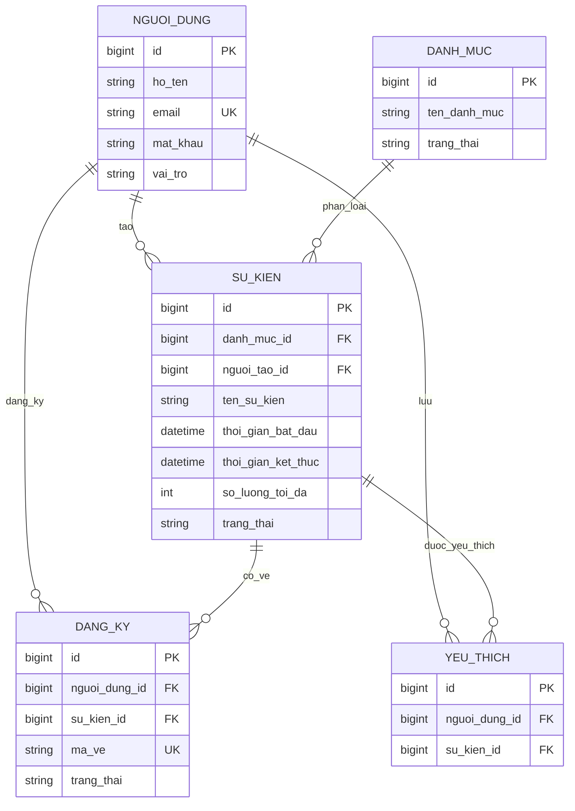

# ERD hệ thống QQQ

Các bảng nghiệp vụ dùng tên tiếng Việt theo migration. `dang_ky` và `yeu_thich` là hai bảng nối giữa người dùng và sự kiện.

Ràng buộc duy nhất: `nguoi_dung.email`, `su_kien.slug`, `dang_ky.ma_ve`, cặp `(dang_ky.nguoi_dung_id, dang_ky.su_kien_id)` và cặp `(yeu_thich.nguoi_dung_id, yeu_thich.su_kien_id)`.
